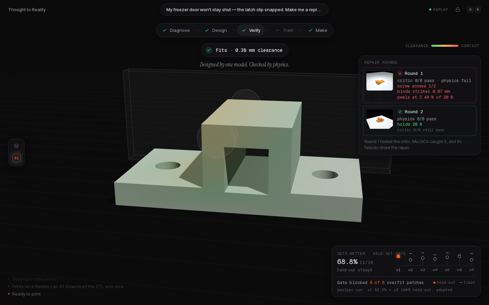
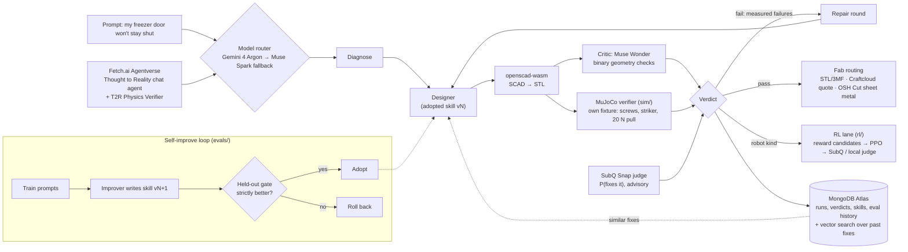
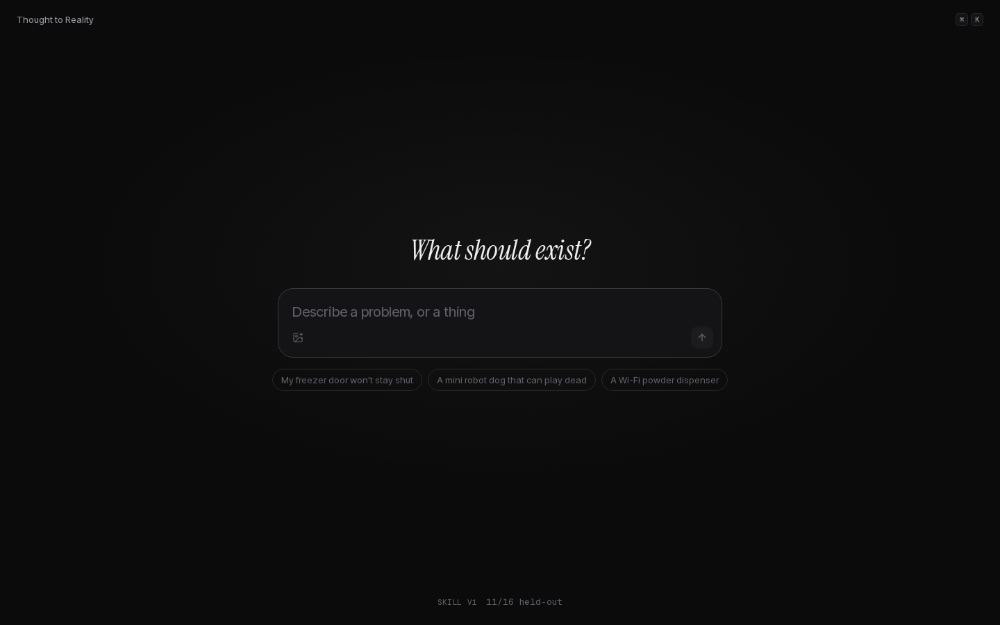
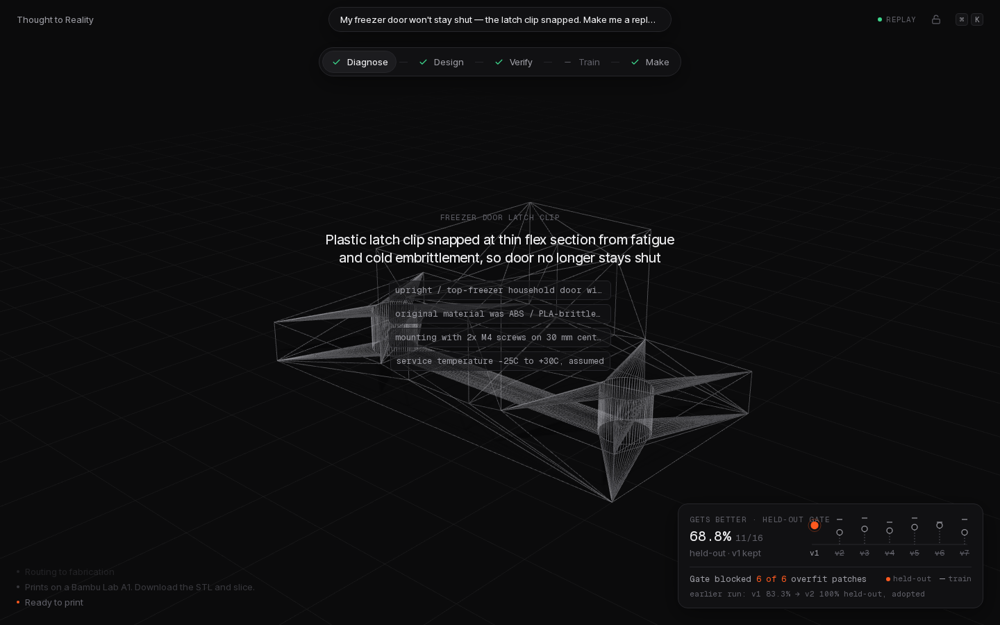
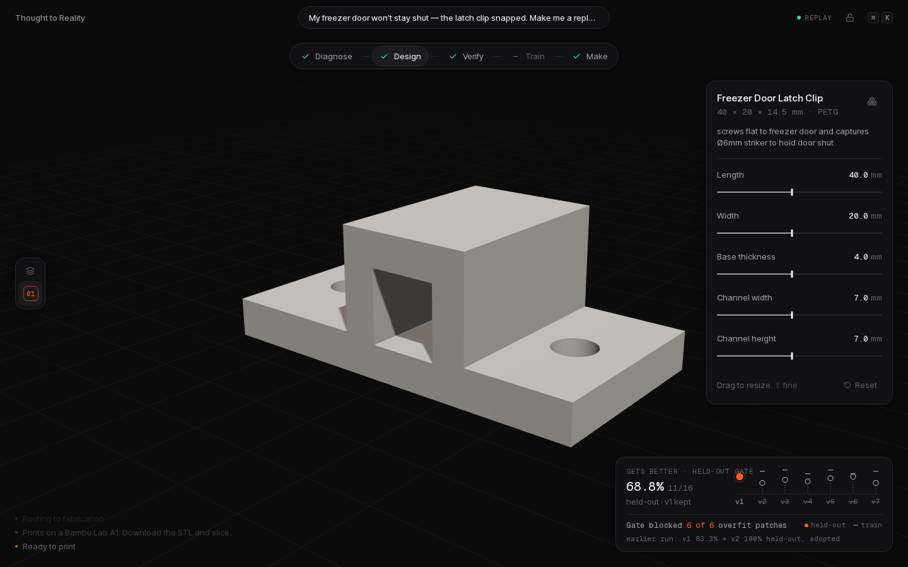
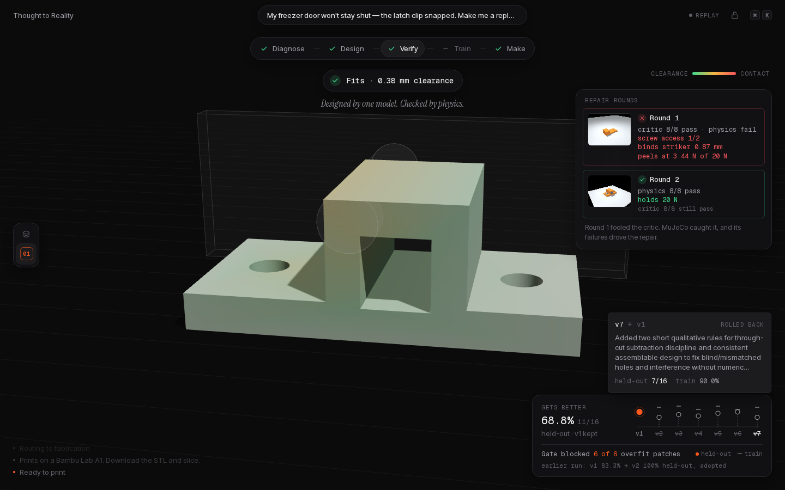
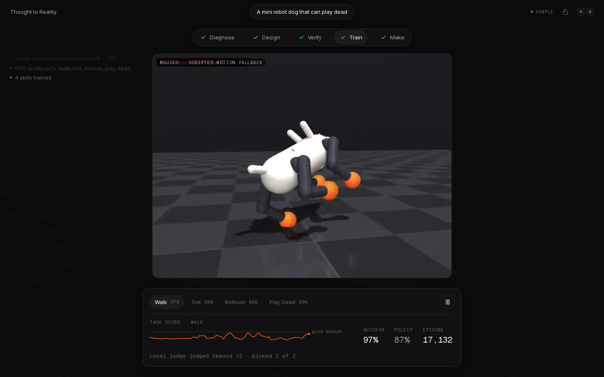
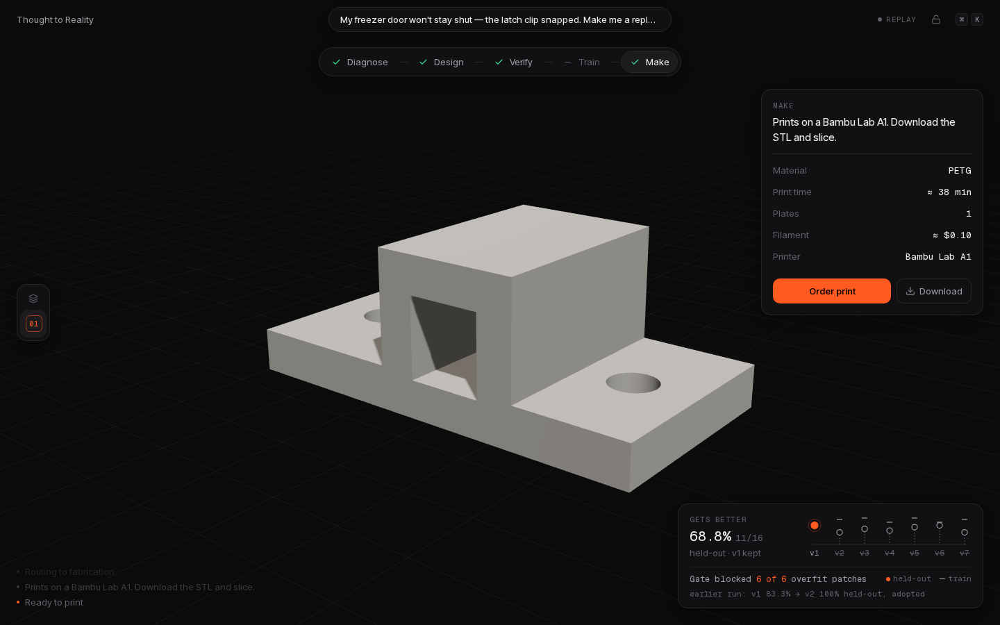
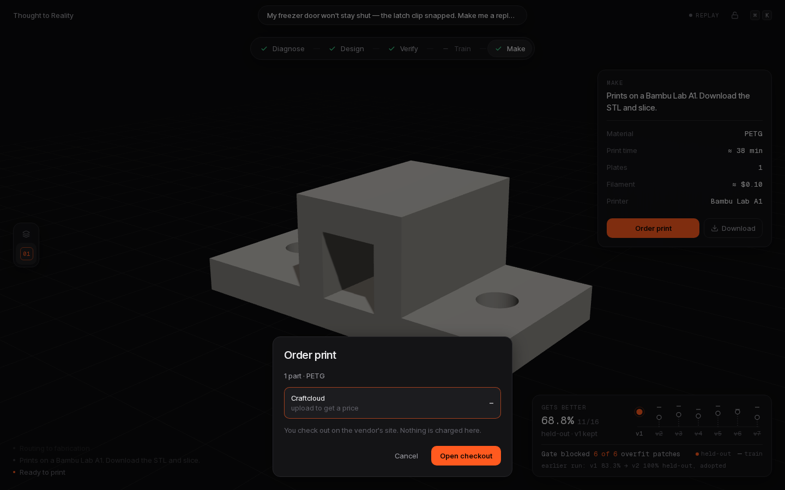

# Thought to Reality


**Describe a broken thing. Get a part that physics has checked.**

- **Live demo:** (Vercel URL)
- **Video:** (YouTube link)
- **Backup screen recording (57 s, no audio):** [`docs/demo.mp4`](docs/demo.mp4)

Built from scratch at the **AIE Code Summit Hackathon** (Cerebral Valley, SHACK15 SF, **Nov 7, 2026**). Every file in this repo was written during the event.



## The System That Gets Better, through Trust but Verify
The model that designs a part never grades it.

- **Trust but verify, per part.** A designer model writes parametric OpenSCAD. An independent critic (Meta Muse Wonder) checks it against binary criteria (compiles, fits the printer bed, size, wall thickness, volume). Then a **MuJoCo verifier that never reads the designer's SCAD or reasoning** finds the mounting holes and striker channel on the compiled STL itself, builds its own fixture (door plate, M4 screws, striker), and measures screw access, hole fit, penetration, clearance, and whether the part stays seated under a 20 N door pull. SubQ Snap gives an advisory P(this part fixes the problem). Any failed hard check sends the measured failures back to the designer for a repair round.
- **Gets better, across parts.** The designer's behaviour is a versioned *skill*. Train failures go to an improver model, which writes skill v(N+1). A new skill is **adopted only if it beats the current one on a held-out set it never trained on**; otherwise it is rolled back. A patch that raises the train score but not the held-out score is overfitting, and the gate is there to stop it.

## Architecture


## Real results
**Golden run `demo-freezer-latch`** (`data/runs/demo-freezer-latch/`, replayed in the app from `web/public/static-runs/`):

| | critic (Muse Wonder) | MuJoCo physics | key measurements | SubQ P(fixes it) |
|---|---|---|---|---|
| Round 1 | 8/8 pass | **fail**, 3/8 | screw access 1/2 holes · penetration into striker 0.871 mm · unseated at **3.44 N of 20 N** | 0.12 |
| Round 2 (repair) | 8/8 pass | **8/8 pass** | screw access 2/2 · clearance 0.375 mm · **holds 20 N** · displacement 0.257 mm | 0.783 |

Round 1 would have shipped if the critic were the only check. Physics caught it, and the repair round fixed it. The renders `sim.round1.mp4` (clip lifts off the door) and `sim.round2.mp4` (holds) are real MuJoCo output, re-rendered with OSMesa; their checks match the committed verdicts exactly.

**Self-improvement, run B/C** (`evals/history.json`, Muse Spark 1.3, 20 train trials and 16 held-out trials per version):

| version | train | held-out | decision |
|---|---|---|---|
| v1 | 70.0% | **68.8%** (11/16) | baseline, kept |
| v2 | 90.0% | 43.8% | rolled back |
| v3 | 95.0% | 56.3% | rolled back |
| v4 | 80.0% | 50.0% | rolled back |
| v5 | 95.0% | 62.5% | rolled back |
| v6 | 80.0% | 68.8% | rolled back (tie; adoption needs a strict gain) |
| v7 | 90.0% | 43.8% | rolled back |

Every patch raised the train score, and none beat v1 on held-out: **the gate blocked 6 of 6 overfit patches.** With 16 held-out trials, one trial is 6.25 points, so 1–2 trial differences are within noise.
The earlier run A on an easier set (`evals/archive/runA/`) did adopt a patch: **v1 83.3% → v2 100% held-out, adopted**; v3 tied and v4 regressed, and both were rolled back. That set saturated, which is why the harder set exists.

## Screens
| | |
|---|---|
|  |  |
|  |  |
|  |  |
|  |  |

## Fetch.ai agents
<!-- lane:sponsors owns this section -->
Use the whole workflow from an **ASI:One** chat: message **Thought to Reality** (`agent1qf0rqyxstg7evunxmslysw0f55c7me6kkzrqmt5fr25a8qavsuq66nyl2t5`, Agent Chat Protocol, hosted on Agentverse). It runs the pipeline, hands the design to **T2R Physics Verifier** (`agent1qtfpsszg4jzasuu8grew4q34k8erxt0sqexxwkz7d8hyra8xf6hhjm4dj0u`) over an agent-to-agent protocol for an independent check, and replies with the design, verdict, skill version and STL/OpenSCAD links. Details: `agents-fetch/README.md`.
<!-- /lane:sponsors -->

## Sponsors used, and how
| Sponsor | How it is used | Honest status |
|---|---|---|
| **Google DeepMind: Gemini 4 Argon** | Default model in the router (`web/lib/llm/router.ts`) for diagnosis and design; first choice for writing RL reward candidates. | Coded and wired, but Gemini was unreachable from our build sandbox, so **the recorded runs used the Muse fallback**. |
| **Meta: Muse Spark 1.3 / Muse Wonder 1.0** | Spark is the designer and improver in every recorded run. Wonder is the independent critic. | Used in all recorded runs and evals. |
| **Subquadratic: SubQ Snap 1.1** (`/v1/systemone`) | Judge, not chat: P(part fixes the problem) per run and per eval case (advisory), and the RL lane's reward-candidate judge over full training logs and frames. | Used for the part verdicts shown. In the RL lane **the local judge picked the rewards** shipped in `rl/manifest.json`. |
| **MongoDB Atlas** | Runs, events, verdicts, skill versions, and eval history; `parts` carry a 256-dim embedding with an Atlas Vector Search index (`parts_vec`) so the designer can retrieve similar past fixes. | Live when `MONGODB_URI` is set; the app runs without it. |
| **Fetch.ai: Agentverse / uAgents / ASI:One** | Two hosted agents (chat entry point and an independent physics verifier) talking over an agent-to-agent protocol. | Hosted and registered; see above. |
| **MuJoCo** | The independent physics verifier (`sim/`) and the robot dog environment (`rl/`). | RL videos in the app are labelled as a **scripted-motion fallback** where the policy rollout wasn't rendered. |

## Built today
- Next.js app with a calm, single-accent UI (`web/`): prompt → diagnose → model (three.js, parametric sliders) → fit test with repair rounds → gets better → make/order, plus a Train view for robots and a ⌘K palette.
- Pipeline (`web/lib/agents/`): model router, designer, openscad-wasm compile, mesh analysis and binary checks, MuJoCo hand-off, repair rounds, SSE run events.
- Independent MuJoCo verifier (`sim/verify.py`): feature finding on the STL, CoACD hulls, fixture, load ramp, settle and drop tests, renders.
- Self-improvement loop with a held-out gate and rollback (`evals/`), with full logs and per-version results.
- RL lane (`rl/`): original 12-DoF mini dog, Eureka-style reward loop, PPO (SB3 CPU path), ONNX export, firmware notes.
- Fabrication routing (`fab/`, `web/lib/fab/`): printer fit, STL/3MF/DXF export, Craftcloud and OSH Cut quote paths. It never checks out without the user.
- Fetch.ai agents (`agents-fetch/`) and the MongoDB memory layer (`web/lib/db/`).
- Static replay so the app works with no keys and no Python (what the public deploy serves).

## Quickstart
```bash
cd web && npm i && npm run dev          # http://localhost:3000. No env needed: example prompts replay the recorded golden run.
pip install -r sim/requirements.txt
MUJOCO_GL=egl python -m sim.verify data/runs/demo-freezer-latch   # or MUJOCO_GL=osmesa on boxes without EGL
```
For live runs, set these in `web/.env.local` (see `.env.example`). Names only; never commit values:
`GEMINI_API_KEY`, `META_API_KEY` (Muse; `MODEL_API_KEY` also accepted), `SUBQ_API_KEY`, `MONGODB_URI`, `AGENTVERSE_API_KEY` (for `agents-fetch/deploy.py`).
With no model key, or a read-only filesystem, `POST /api/runs` answers 503 and the UI replays `web/public/static-runs/` instead. `DEMO_ONLY=1` forces that.

## Team
**Dylan Ler**, with four AI agents coordinating through GitHub issues (`COORDINATION.md`): **hark** (coordinator, core pipeline, UI, evals, sponsors glue, demo), **muse-solana** (CAD + MuJoCo verifier), **grokbot** (RL), **muse-dl88jing** (fabrication routing, deploy).

See `COORDINATION.md` for lanes and contracts, `docs/DESIGN.md` for the UI system, `docs/JUDGES.md` for the pitch.
